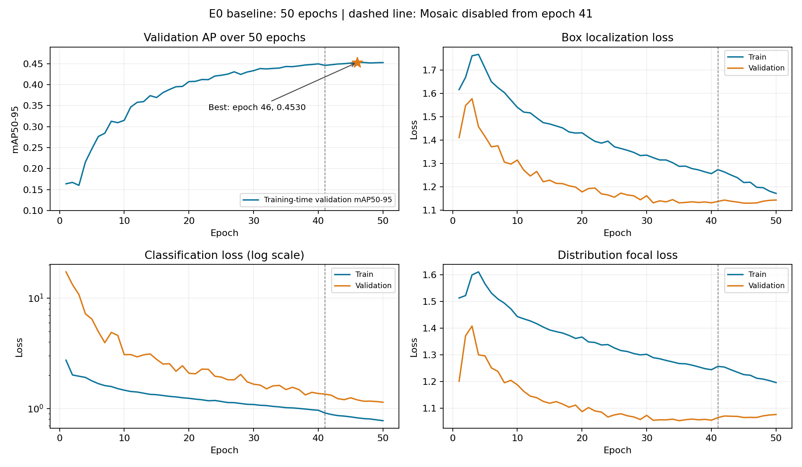

# E0: YOLOv8n 50 epoch Baseline 결과

2026-10-31 (KST). E0는 정상 완료됐으며 이후 실험과 비교할 첫 학습 기준을 확보했다.
핵심 개선 과제는 불꽃 객체의 누락과 오탐이다. 최종 Test 성능은 평가하지 않았다.
정확한 수치·설정·환경·해시와 원본 기록 경로는 [JSON 보고서](004_e0_baseline.json)에 있다.

## 실행 조건과 무결성

- 소스: `44e9e24087cfc9db8dd765bab01ea55d6349dbb6`, Git clean.
- COCO YOLOv8n에서 새로 학습, seed 42, 50 epochs, imgsz 640, batch 16,
  명시적 MuSGD, lr0 0.01, linear decay, patience 0, workers 0, FP32.
- 초기 COCO checkpoint SHA256:
  `f59b3d833e2ff32e194b5bb8e08d211dc7c5bdf144b90d2c8412c47ccfc83b36`.
- 데이터: `dfire-fold1-v2`, Train 13,776 / Val 3,445 / Test 4,306.
  fingerprint: `c3d63dfa73314a36b5522f4651f5fd7d784bd8a054e78916f821160729862e2b`.
- 학습: 19:13:48 ~ 22:21:39 KST, wall time 11,270.47초(3시간 7분 50초).
  중단·재개 없이 50 epochs를 완료했다.
- 학습 peak CUDA allocated 3.248 GiB, reserved 5.211 GiB. 시스템 전체 VRAM과 구분한다.
- MuSGD의 비어 있지 않은 parameter group은 initial_lr 0.01이었다.
  nominal batch 16, 기본 accumulation 4(nbs 64)이며 warmup 중 accumulation/LR은 달라진다.
- 학습 loader 준비 후·학습 종료 시, 별도 평가 종료 시 데이터 무결성 검사를 통과했다.

## 최고 모델과 두 평가 방식

학습 내부 Validation mAP50-95 최고는 **46 epoch의 0.45303**이었다.
이때 mAP50 0.77143, Precision 0.76282, Recall 0.70827이었다.
저장된 `best.pt`의 train_metrics도 CSV의 이 결과와 일치했다.
마지막 50 epoch mAP50-95는 0.45269로 최고보다 0.00034 낮았다.

`best.pt` SHA256:
`6181df582cf9dfbfbeaacf61481df39c565e5f8ac9ddca4765f8c03349c1b696`.

저장된 모델을 프로젝트 공통 명령으로 평가한 결과는 아래와 같다.
AP confidence 0.001, NMS IoU 0.7, max_det 300, batch 16,
정사각형 padding(`rect=false`), FP32, Validation 3,445장이다.

| 클래스 | AP50 | AP50-95 | Precision* | Recall* | F1* |
|---|---:|---:|---:|---:|---:|
| All | 0.76827 | 0.44745 | 0.77394 | 0.70032 | 0.73518 |
| Smoke | 0.83886 | 0.52422 | 0.83295 | 0.77074 | 0.80064 |
| Fire | 0.69768 | 0.37068 | 0.71493 | 0.62990 | 0.66973 |

*Ultralytics 최대 평균 F1 confidence 지점의 P/R/F1이다. 아래 고정 confidence 결과와 다르다.
mAP는 위치·분류를 여러 confidence 및 IoU 기준으로 종합한 점수다.

학습 로그와 별도 평가의 차이를 확인하기 위해 설치된 Ultralytics 소스와 실제 실행을 검사했다.
학습 중 Validation loader는 `rect=true`, batch 32(학습 batch의 2배)를 사용한다.
같은 `best.pt`를 이 조건으로 다시 평가하니 mAP50-95 **0.45291**로 재현됐다.
따라서 패딩/배치 조건 차이가 주요 원인임을 확인했다. 학습 CSV와의 잔차 약 0.00012는
원인을 분리 검증하지 않았으므로 확정하지 않는다.

이후 실험의 결과 비교는 같은 `evaluate` 조건의 **0.44745**를 기준으로 한다.
학습 곡선에는 학습 내부 지표를 유지한다. 50개 checkpoint를 공통 평가로 모두 재정렬하지
않았으므로 46 epoch를 공통 평가 조건에서도 최적인 epoch라고 단정하지 않는다.

## 고정 confidence에서의 실제 탐지

Confidence 0.25, NMS IoU 0.7, class-aware 1:1 greedy IoU matching 0.5로 집계했다.

| 클래스 | Precision | Recall | F1 | TP | FP | FN |
|---|---:|---:|---:|---:|---:|---:|
| Smoke | 0.76615 | 0.80995 | 0.78744 | 1,530 | 467 | 359 |
| Fire | 0.61743 | 0.69081 | 0.65206 | 1,488 | 922 | 666 |

불꽃 정답 객체 2,154개 중 666개(30.92%)가 이 조건에서 정답과 일치하는 탐지로 잡히지 않았다.
이는 객체·IoU 기준 누락이며 화재 사건 단위의 누락률이나 실제 환경의 확률을 뜻하지 않는다.
전체 불꽃 FP 922개에는 정상 이미지뿐 아니라 양성 이미지 위 잘못된 박스도 포함된다.

정답 객체가 없는 Negative 이미지 1,610장 중 37장(2.30%)에서 오탐이 발생했고,
두 클래스 합산 FP detection은 41개였다. 단일 이미지 여러 검출이 가능하므로 수가 다르다.

Warmup 후 batch 1 평균 추론 4.906 ms/image, 203.84 inference FPS,
전처리+추론+NMS pipeline은 6.819 ms/image, 146.64 FPS였다.
파일 I/O·사례 이미지 저장·영상 파이프라인·실시간 카메라 비용은 제외된 수치다.

## 학습 곡선의 해석



| Epoch | 학습 내부 mAP50-95 |
|---|---:|
| 1 | 0.16392 |
| 10 | 0.31516 |
| 20 | 0.40742 |
| 30 | 0.43346 |
| 40 | 0.44965 |
| 46 | 0.45303 |
| 50 | 0.45269 |

측정 사실: 학습 loss는 전반적으로 감소했고 Validation AP는 초반 빠르게 상승했다.
40 epoch 이후 최고까지의 증가량은 0.00338(약 0.34 AP percentage points)로 작았다.
Validation box loss는 46 epoch의 1.12921에서 마지막 1.14271로 소폭 상승했고,
DFL loss는 35 epoch의 최소 1.05301에서 마지막 1.07630으로 상승했다.
반면 Validation classification loss는 마지막까지 감소했다.

해석: 후반부 성능 포화와 일부 위치 추정 손실의 약화 징후가 있다.
심한 과적합이라고 단정할 만큼 Validation AP가 지속적으로 크게 하락한 것은 아니다.
41 epoch부터 Mosaic이 꺼지므로 해당 구간의 train loss 변화에는 입력 증강 조건 변화도 포함된다.
불꽃 클래스가 약한 원인은 크기·배경·가림·라벨 품질별 FP/FN 분석 전에는 확정하지 않는다.

## 공개 모델 참고값과 다음 실험

같은 로컬 데이터 fingerprint와 공통 평가 조건의 공개 모델 AP50-95는 0.54971,
E0는 0.44745였다. 고정 Fire Recall은 공개 모델 약 0.77716, E0 약 0.69081이었다.
공개 모델 학습 데이터와 현재 Validation의 중복 여부는 미확인이므로 이 차이를
엄격한 일반화 성능 우열이나 학습 방식의 효과로 해석하지 않는다.
게시자의 Test 수치 0.430과 E0의 Validation 수치를 비교해 개선을 주장해서도 안 된다.

다음은 **E1: 같은 COCO 초기 가중치에서 100 epoch를 새로 학습**하는 실험이다.
나머지 설정·seed·데이터·공통 평가를 유지하고 추가 학습의 효과를 확인한다.
epochs에 연동된 LR decay 기간과 Mosaic 종료 시점도 달라짐을 함께 기록한다.
후반 포화가 있어 100 epoch의 큰 개선은 실행 전 보장할 수 없다.
그다음 학습률·증강·해상도를 독립 비교한다. 단일 seed 결과이므로 작은 차이는
반복 seed 결과 없이 확정적인 우위로 판단하지 않는다.

```powershell
.\.venv\Scripts\python.exe firelab.py train --id E1
```

원본 학습/평가 폴더는 `experiments/runs/`에, 비교 CSV/JSON과 그래프는
`outputs/comparison_20261031T135601Z_a8e7e069/`에 있다. 가중치·원본 이미지·전체 run은 Git에서 제외했다.
