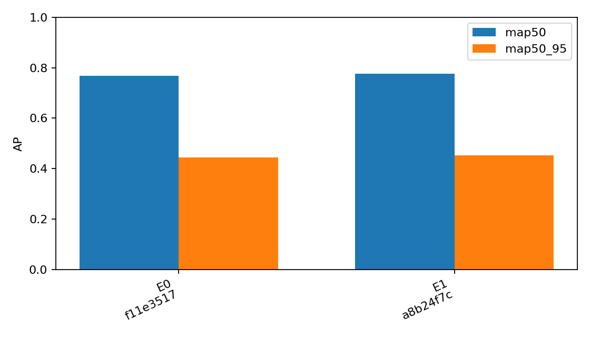
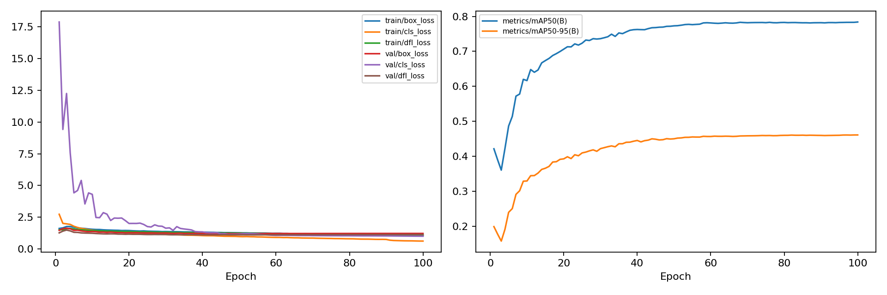

# 서버 E1 학습 및 공통 Validation

실제 100 epochs 학습과 공통 Validation을 완료했다.

- 최대 epoch: 100; patience: 0; 종료 사유: epoch_limit.
- 학습: `/root/drone-fire-detection/experiments/runs/E1_20261104T055200Z_0a27f400`
- 평가: `/root/drone-fire-detection/experiments/runs/val-E1_20261104T163213Z_a8b24f7c`
- 모델 SHA256: `0ec8895995297b781bf112215af073721b9775cbbbd27e7ac36b248f0b242e1d`
- 데이터 fingerprint: `c3d63dfa73314a36b5522f4651f5fd7d784bd8a054e78916f821160729862e2b`
- 기준 E0 대비 mAP50-95 변화: +0.700%p (단일 seed 관측).
- 공통 mAP50: 0.77651; mAP50-95: 0.45160.
- confidence 0.25 Fire Recall: 0.72145; TP/FP/FN: 1554/914/600.
- Negative 오탐 이미지: 26/1610; 검출 27개.
- 학습 시간: 38288.1초; 배치 1 FP32 추론 5.158ms/장.
- 비교 CSV·JSON·loss/AP 곡선·그래프: `/root/drone-fire-detection/outputs/comparison_20261104T164716Z_02b9eb3a`.

AP의 P/R은 최대 평균 F1 지점이며 confidence 0.25 운영 P/R과 구분한다. 학습 내부 Validation의 padding/batch 차이 때문에 후보 비교에는 공통 Validation만 사용한다.

세부 effective 인자·optimizer/LR·버전·Git 상태·GPU 메모리·클래스별 AP 및 운영 지표는 동명 JSON과 run 원본에 보존한다. 하드웨어/버전별 속도 차이와 단일 seed 한계가 있다. 출처별 video/session ID가 없어 근접 프레임 누수를 보장하지 못하며 공개 모델 split과 다르다. Test는 평가하지 않았다.

E1은 서버 E0의 50 epoch와 비교하는 100 epoch 실험이다. 총 epoch와 이에 연동된 학습률 일정·Mosaic 종료 시점의 차이를 함께 해석하며, 단일 seed 관측으로 통계적 우위를 확정하지 않는다.

## 검토한 실측 비교와 학습 곡선

2026-11-05(KST) 검토. 완료된 서버 E0와 E1의 공통 Validation만 비교한다. 자동 생성 원본은 [측정 JSON](010_server_e1.json), 원본/파생 파일 해시와 epoch별 근거는 [검토 JSON](010_server_e1_review.json), 비교 표는 [CSV](010_server_e1_comparison.csv)에 보존한다.

| 지표 | 서버 E0 | 서버 E1 |
|---|---:|---:|
| 실제/최대 epoch; patience | 50/50; 0 | 100/100; 0 |
| 공통 mAP50 | 0.76692 | 0.77651 |
| 공통 mAP50-95 | 0.44459 | 0.45160 |
| Fire Precision, conf 0.25 | 0.62142 | 0.62966 |
| Fire Recall, conf 0.25 | 0.69499 | 0.72145 |
| Fire TP / FP / FN | 1497 / 912 / 657 | 1554 / 914 / 600 |
| Negative 오탐 이미지 | 27/1610 | 26/1610 |
| Negative 오탐 검출 | 30 | 27 |
| 학습 시간 | 5시간 23분 34초 | 10시간 38분 8초 |

공통 mAP50-95 변화는 **+0.700%p**, 고정 Fire Recall 변화는 **+2.646%p**다. 학습 시간은 서버 E0의 1.972배다. 반복 seed 없이 통계적 우위를 확정하지 않는다.

### 클래스별 공통 Validation

| 클래스 | AP50 | AP50-95 | Precision* | Recall* |
|---|---:|---:|---:|---:|
| smoke | 0.84037 | 0.52555 | 0.84369 | 0.78560 |
| fire | 0.71265 | 0.37764 | 0.72128 | 0.64531 |

*최대 평균 F1 confidence 지점의 P/R이다. 위 conf 0.25 운영 P/R과 구분한다.

### 실제 학습 곡선과 해석

| epoch | 내부 mAP50-95 | train box loss | val box loss | val cls loss |
|---:|---:|---:|---:|---:|
| 25 | 0.40942 | 1.40536 | 1.25684 | 1.76496 |
| 50 | 0.44989 | 1.27431 | 1.20657 | 1.16771 |
| 60 | 0.45637 | 1.23256 | 1.22075 | 1.07084 |
| 75 | 0.45900 | 1.16375 | 1.22106 | 1.04289 |
| 90 | 0.45954 | 1.10451 | 1.22460 | 1.02688 |
| 100 | 0.46083 | 1.04411 | 1.22422 | 1.00449 |

내부 최고는 100 epoch의 0.46083다. 후반부 train loss는 감소하지만 내부 AP 증가 폭은 작고 val box loss는 50 epoch보다 높다. 포화와 일부 위치 추정 손실 악화의 징후로 해석하며, 심한 과적합을 단정하지 않는다. 91 epoch부터 Mosaic이 꺼지므로 해당 구간의 train loss 변화에는 증강 전환도 포함된다.

### 실행 환경과 보존 범위

- 학습 시작/종료(KST): `2026-11-04T14:52:00.828696+09:00` / `2026-11-05T01:30:08.948438+09:00`.
- 최초 학습 Git: `6184d2b9e232a8695028a09b8ad5f5bf45c1e48c`; 단일 attempt, resume=false.
- Python 3.10.12, torch 2.10.0+cu128, CUDA 12.8, Ultralytics 8.4.0; GPU `NVIDIA A100 80GB PCIe MIG 1g.10gb`.
- 학습 GPU peak allocated/reserved: 3.277 / 5.553 GiB.
- batch 1 FP32 추론: 5.158 ms/장, 193.89 FPS. I/O·전처리·NMS를 제외한 측정이다.
- 별도 공통 평가: Val 3,445장, imgsz 640, AP batch 16/rect=false/FP32, AP conf 0.001, 운영 conf 0.25, NMS IoU 0.7, 매칭 IoU 0.5, max_det 300.
- 평가 중 자원 관측: CPU quota `229000 100000`; 평가 프로세스 전체 스레드 194개. 관측 시각과 CPU throttling 카운터는 검토 JSON에 보존한다.
- 전체 클래스 지표·혼동행렬·운영 FP/FN은 측정 JSON과 원격 Validation run에 보존한다. 원본 이미지나 가중치를 이 커밋에 포함하지 않는다.

E0→E1의 총 epoch 변경은 LR decay 기간과 Mosaic 종료 시점도 바꾼다. 이후 E2~E4의 최대 60 epoch/patience=15 결과는 100 epoch E1과 예산이 다른 후보 탐색이다. 유망한 후보는 같은 100 epoch 조건에서 별도 검증한다. 서버 자원 공유와 읽기 전용 점검의 동시 실행이 시간 측정에 영향을 줄 수 있어 속도 우위를 주장하지 않는다. 공개 모델과 split이 다르고 video/session 그룹 정보가 없어 근접 프레임 누수 가능성도 남는다. 최종 모델·threshold를 동결하지 않았으며 Test는 평가하지 않았다.
