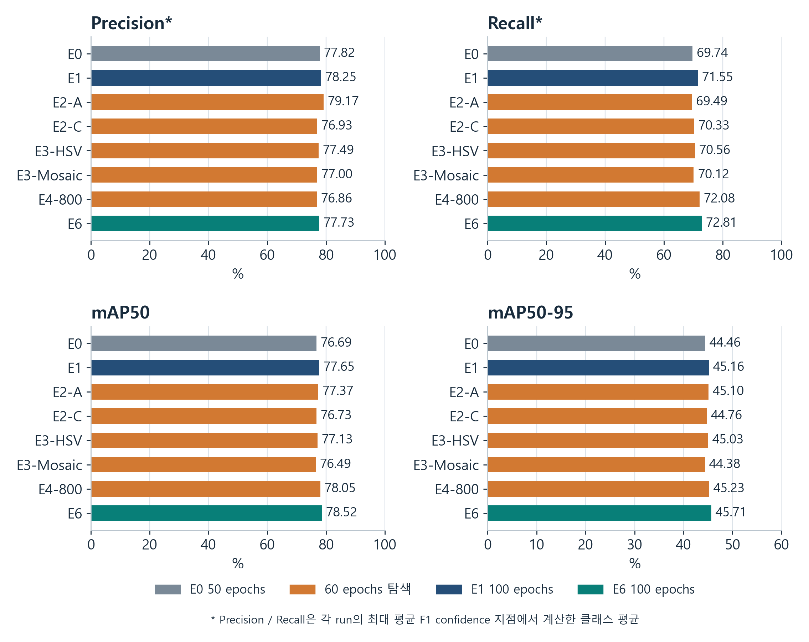
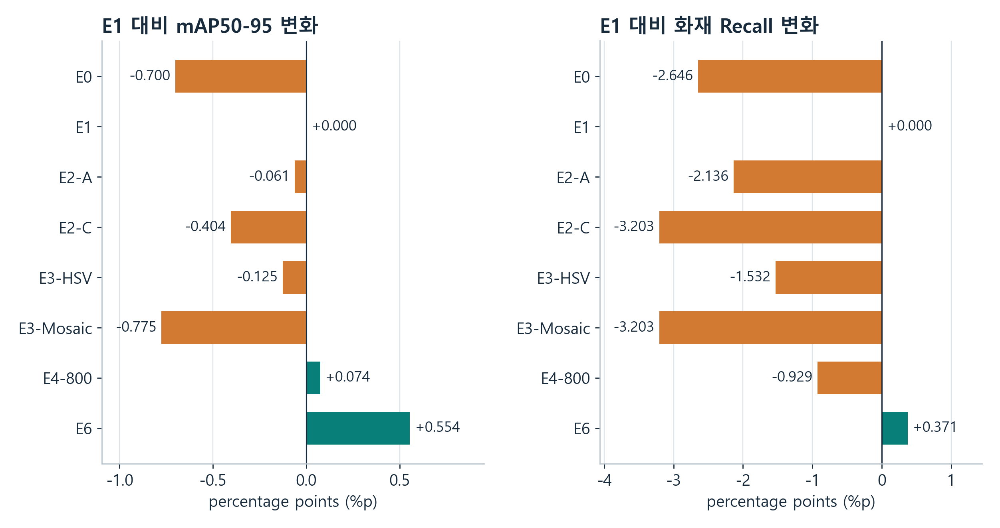
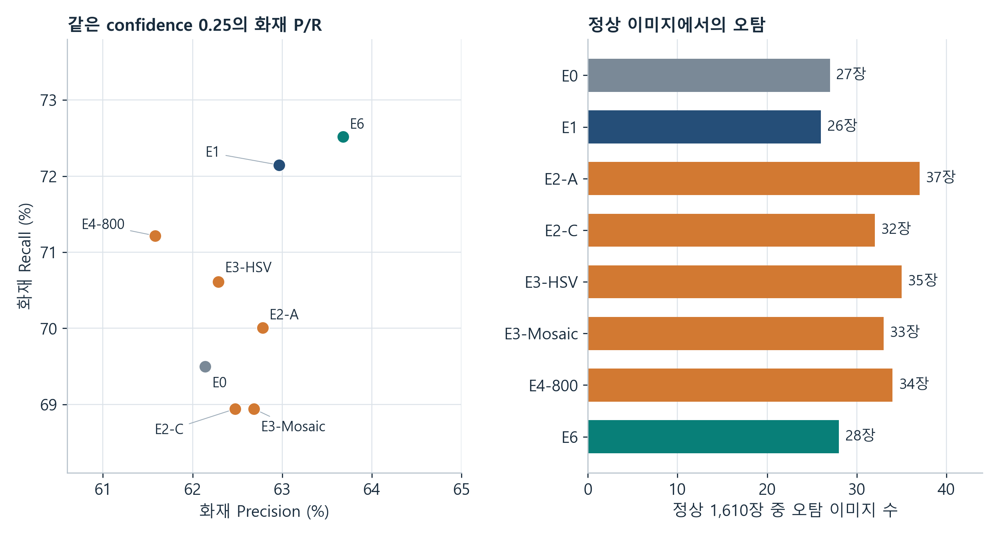
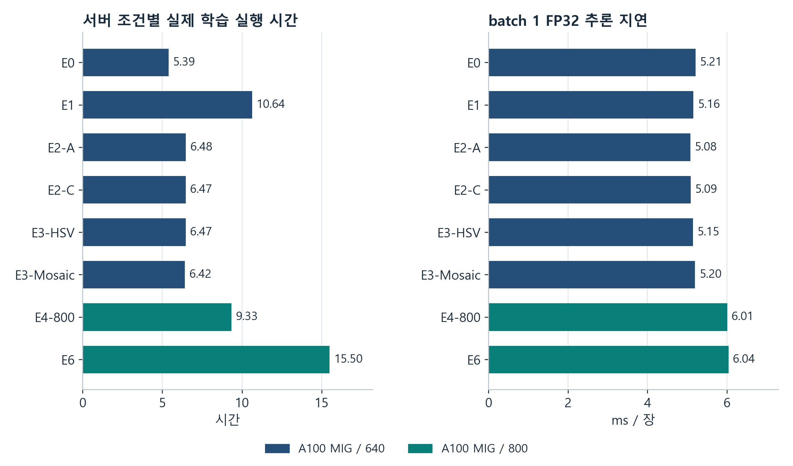
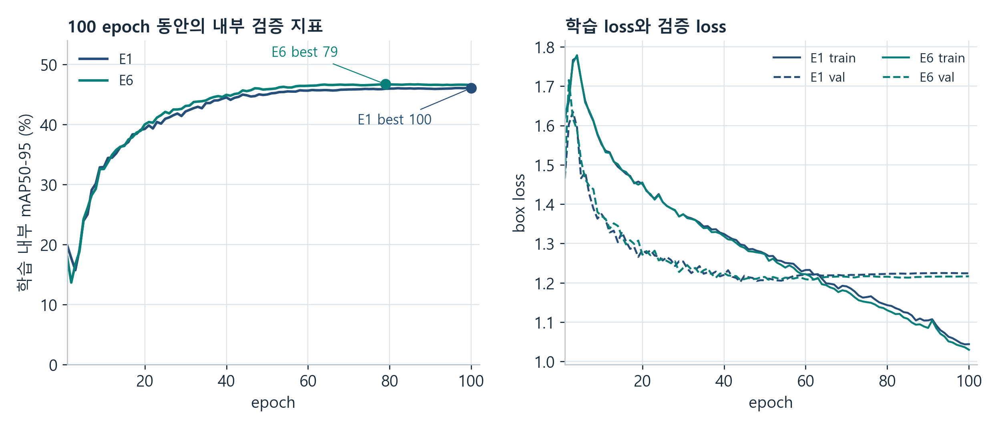

# 화재와 연기 감지 모델 실험 보고서

2026-11-10 수정 · A100 MIG GPU 서버 · YOLOv8n · D-Fire · E0부터 E6까지

YOLOv8n과 D-Fire를 이용해 GPU 서버에서 실행한 E0부터 E6까지의 설정 변화와 측정 결과를 정리했다. 실측 학습 기간은 2026년 11월 4일부터 11월 7일까지이며 문서 수정일은 2026년 11월 10일이다. 모든 실측 비교는 동일한 A100 MIG 서버 환경의 기록에 근거한다.

E6의 해상도 800·100 epoch 조건이 공통 Validation mAP50-95 45.71%로 가장 높았다. E1 대비 개선 폭은 0.554%p이며, 같은 confidence 0.25의 화재 Recall은 72.14%에서 72.52%로 증가했다. 표준 Precision의 최고값은 E2-A의 79.17%이고, 서버 조건 중 정상 이미지 오탐이 가장 적은 실험은 E1의 26장이었다.

| 항목 | 관측 결과 |
|---|---|
| 집계 범위 | A100 MIG 서버에서 완료한 run 8개 |
| 입력과 클래스 | D-Fire 공식 fold 1 smoke 0 / fire 1 |
| 데이터 규모 | Train 13,776장 / Validation 3,445장 / Test 4,306장 |
| 학습 시간 합계 | 66:41:56 / 약 66시간 42분 |
| 현재 단계 | Validation 결과를 근거로 최종 모델과 threshold 선택 대기 |

### 평가 지표를 읽는 방법

| 지표 | 읽는 방법 |
|---|---|
| Precision | 검출한 객체 중 올바른 검출의 비율이다. TP / (TP + FP)로 계산한다. |
| Recall | 실제 객체 중 찾아낸 비율이다. TP / (TP + FN)로 계산한다. |
| F1 | Precision과 Recall의 조화평균이다. 표의 macro F1은 클래스별 F1의 평균이다. |
| mAP50 | 박스 중첩 기준 IoU 0.50에서 confidence를 변화시켜 얻은 AP의 클래스 평균이다. |
| mAP50-95 | IoU 0.50부터 0.95까지 0.05 간격의 AP를 평균한 지표다. 이 프로젝트의 주 선택 기준이다. |
| 정상 오탐 이미지 | 정상 이미지 1,610장 중 검출이 한 번 이상 발생한 이미지 수다. |

TP는 올바른 검출, FP는 잘못된 검출, FN은 미검출 객체를 뜻한다. 본문의 성능 수치는 공통 Validation 측정값이다. E5는 batch 탐색을 위한 계획 상태로 표시한다.

## 실험 설계와 변경한 값

각 실험은 SHA256이 고정된 COCO 사전학습 YOLOv8n에서 독립적으로 시작했다. 설정을 검토하는 순서는 E0부터 E6까지이며, 다음 조건을 시작할 때 COCO 초기 가중치를 다시 불러왔다. 같은 데이터 분할과 클래스 정의를 유지했다.

| 실험 | 주요 설정 | 완료 epoch / patience | GPU |
|---|---|---|---|
| E0 | 기준 모델 640 / lr0 0.01 | 50 / 0 | A100 MIG |
| E1 | 640 입력에서 학습 예산 100 epoch | 100 / 0 | A100 MIG |
| E2-A | lr0 0.01에서 0.005로 조정 | 60 / 15 | A100 MIG |
| E2-C | lr0 0.01에서 0.02로 조정 | 60 / 15 | A100 MIG |
| E3-HSV | hsv_s 0.7에서 0.5 / hsv_v 0.4에서 0.2 | 60 / 15 | A100 MIG |
| E3-Mosaic | mosaic 확률 1.0에서 0.5로 조정 | 60 / 15 | A100 MIG |
| E4-800 | 입력 해상도 640에서 800으로 조정 | 60 / 15 | A100 MIG |
| E5 | batch 8 / 32 탐색 계획 | 계획 | 선택 단계 |
| E6 | 해상도 800 후보를 100 epoch로 검증 | 100 / 0 | A100 MIG |

### 공통 학습 조건

batch 16, seed 42, MuSGD, FP32, workers 0, lr0 기본값 0.01, lrf 0.01, linear learning-rate decay를 사용했다. 기본 HSV는 h 0.015 / s 0.7 / v 0.4이며 기본 mosaic 확률은 1.0이다. 설정표의 변경 항목을 각 조건에 적용했다. E2부터 E4까지는 모두 최대 60 epoch에 도달해 완료됐다.

### 학습 예산과 비교 범위

E2·E3·E4는 학습 시간을 줄이기 위해 최대 60 epoch와 patience 15로 탐색했다. E1은 100 epoch와 patience 0이다. 따라서 E1과 탐색 조건의 차이에는 설정 변경과 학습 예산 차이가 함께 포함된다. 60 epoch·640·lr0 0.01의 기본 조건은 별도로 측정한 기록이 없다.

최대 epoch를 바꾸면 학습률 감소 일정과 마지막 10 epoch의 Mosaic 종료 시점도 달라진다. E1과 E6는 같은 100 epoch / patience 0 / seed 42 조건이며 학습 설정 중 imgsz에서 차이가 난다. E4와 E6 비교에는 60 epoch에서 100 epoch로 바뀐 전체 학습 일정이 포함된다.

### 공통 평가 조건

Validation 3,445장에 AP confidence 0.001, NMS IoU 0.7, max_det 300, batch 16, rect=false, FP32를 사용했다. 운영 지표는 confidence 0.25, 매칭 IoU 0.5에서 별도로 집계했다. 이미지 입력 해상도는 각 학습 조건의 640 또는 800을 적용했다.

## 전체 Precision Recall과 mAP 비교

| 실험 | Precision* | Recall* | F1 macro* | mAP50 | mAP50-95 |
|---|---|---|---|---|---|
| E0 | 77.82 | 69.74 | 73.55 | 76.69 | 44.46 |
| E1 | 78.25 | 71.55 | 74.74 | 77.65 | 45.16 |
| E2-A | 79.17 | 69.49 | 73.99 | 77.37 | 45.10 |
| E2-C | 76.93 | 70.33 | 73.47 | 76.73 | 44.76 |
| E3-HSV | 77.49 | 70.56 | 73.85 | 77.13 | 45.03 |
| E3-Mosaic | 77.00 | 70.12 | 73.38 | 76.49 | 44.38 |
| E4-800 | 76.86 | 72.08 | 74.39 | 78.05 | 45.23 |
| E6 | 77.73 | 72.81 | 75.18 | 78.52 | 45.71 |

표의 비율 단위는 모두 %다. *표준 Precision·Recall·F1은 각 실험에서 평균 F1이 최대인 confidence 지점의 클래스 평균이다. 공통 confidence 0.25의 운영 P/R은 다음 운영 비교 표에 따로 제시한다.

그림 1  A100 MIG 서버의 8개 run을 비교했다. 색상은 학습 예산과 기준 조건을 나타낸다. 각 run의 공통 Validation 결과를 표시했다.

E6의 mAP50은 78.52%, mAP50-95는 45.71%다. E1의 표준 Precision은 78.25%로 E6의 77.73%보다 높고, 표준 Recall은 E1 71.55%에서 E6 72.81%로 증가했다. 모델 선택에는 이 P/R 변화와 주 지표 mAP를 함께 읽어야 한다.

## 학습 길이 학습률과 증강의 변화

그림 2  E1을 기준으로 mAP50-95와 confidence 0.25 화재 Recall의 차이를 %p로 표시했다. 60 epoch 탐색과 100 epoch 기준의 예산 차이가 포함돼 있다.

### E0에서 E1로 학습 예산 확대

같은 A100 MIG 환경에서 50 epoch E0의 mAP50-95는 44.46%, 100 epoch E1은 45.16%였다. 0.700%p 높아졌고 화재 Recall은 69.50%에서 72.14%로 2.646%p 증가했다. 정상 오탐 이미지는 27장에서 26장으로 줄었다. 학습 시간은 5시간 24분에서 10시간 38분으로 늘었다.

### E2에서 lr0 0.005와 0.02 탐색

같은 60 epoch 예산에서 lr0 0.005인 E2-A는 mAP50-95 45.10%, lr0 0.02인 E2-C는 44.76%였다. E2-A가 0.343%p 높았다. E2-A의 표준 Precision 79.17%는 서버 실험 중 최고였지만 화재 Recall은 70.01%였고 정상 오탐은 37장이었다. 100 epoch E1과의 mAP 차이는 -0.061%p였다.

### E3에서 HSV와 Mosaic 탐색

채도·밝기 증강 강도를 줄인 E3-HSV는 mAP50-95 45.03%, Mosaic 확률을 0.5로 줄인 E3-Mosaic는 44.38%였다. 이 탐색에서 E1의 45.16%를 넘는 증강 후보는 나오지 않았다. E3-Mosaic의 mAP50-95는 서버 조건 중 가장 낮았다. 동일 60 epoch의 기본 증강 조건이 별도로 없어 증강 인자만의 효과를 분리한 결론에는 제약이 있다.

## 화재 연기 검출과 정상 이미지 오탐

| 실험 | 화재 P | 화재 R | 연기 P | 연기 R | 정상 오탐 장수 |
|---|---|---|---|---|---|
| E0 | 62.14 | 69.50 | 76.89 | 80.84 | 27 |
| E1 | 62.97 | 72.14 | 78.42 | 82.53 | 26 |
| E2-A | 62.78 | 70.01 | 76.45 | 81.63 | 37 |
| E2-C | 62.47 | 68.94 | 77.88 | 80.89 | 32 |
| E3-HSV | 62.29 | 70.61 | 75.72 | 81.21 | 35 |
| E3-Mosaic | 62.68 | 68.94 | 77.26 | 80.94 | 33 |
| E4-800 | 61.58 | 71.22 | 77.49 | 83.11 | 34 |
| E6 | 63.68 | 72.52 | 76.78 | 82.95 | 28 |

P/R은 %이며 confidence 0.25, 매칭 IoU 0.5 기준이다. Validation의 실제 객체 수는 화재 2,154개와 연기 1,889개다. 정상 오탐의 분모는 1,610장이다.

그림 3  화재 Precision·Recall과 정상 오탐을 함께 비교했다. 산점도는 작은 지표 차이를 보여주기 위해 축 범위를 확대했다.

E1에서 E6로 바뀌면서 화재 TP는 1,554개에서 1,562개, FN은 600개에서 592개, FP는 914개에서 891개가 됐다. E6의 화재 Precision은 1,562 / (1,562 + 891)인 63.68%, Recall은 1,562 / (1,562 + 592)인 72.52%다.

정상 오탐 이미지는 E1 26장과 E6 28장으로 차이가 2장이다. 연기 Precision은 E1 78.42%에서 E6 76.78%로 낮아졌고 연기 FP는 429개에서 474개로 늘었다. 연기 Recall은 82.53%에서 82.95%로 증가했다. 전체 이미지의 객체 FP와 정상 이미지의 오탐 장수는 집계 단위가 다르다.

## 사용 GPU와 실제 학습 시간

모든 실험은 NVIDIA A100 80GB PCIe의 MIG 1g.10gb 할당에서 실행했다. 각 실행에 할당된 GPU 메모리는 9,728 MiB인 약 9.50 GiB였다. 아래 표와 그래프는 동일 서버에서 측정한 실행 시간과 메모리 기록이다.

| 실험 | GPU | 학습 h:mm:ss | 별도 Val m:ss | 할당 GiB | 확보 GiB |
|---|---|---|---|---|---|
| E0 | MIG | 5:23:34 | 1:25 | 3.24 | 5.55 |
| E1 | MIG | 10:38:08 | 14:38 | 3.28 | 5.55 |
| E2-A | MIG | 6:29:03 | 17:22 | 3.24 | 5.55 |
| E2-C | MIG | 6:28:03 | 19:47 | 3.24 | 5.55 |
| E3-HSV | MIG | 6:28:02 | 19:55 | 3.24 | 5.55 |
| E3-Mosaic | MIG | 6:25:01 | 16:36 | 3.23 | 5.52 |
| E4-800 | MIG | 9:19:52 | 24:24 | 4.98 | 6.15 |
| E6 | MIG | 15:30:14 | 15:19 | 5.02 | 6.15 |

그림 4  A100 MIG 서버의 입력 해상도별 학습 시간 및 추론 지연이다. 추론 지연은 warmup 후 batch 1 FP32에서 측정했으며 I/O와 전처리·NMS는 별도다.

서버의 8개 학습 시간 합계는 66:41:56이고 별도 공통 Validation 합계는 2:09:28다. 합계는 이 서버에서 완료된 각 run의 기록된 실행 시간을 더한 값이다.

학습 시간은 학습 run의 wall time으로, 매 epoch 내부 Validation과 checkpoint 저장을 포함한다. 별도 Val은 학습 후 공통 평가의 wall time이다. 큐 사전 검증·대기·보고 과정은 이 두 시간의 합계 바깥에 있다. 할당은 PyTorch 텐서의 peak allocated, 확보는 캐시를 포함한 peak reserved 메모리다.

## E4 해상도 탐색과 E6의 100 epoch 검증

입력 크기를 640에서 800으로 바꾼 E4-800은 60 epoch 탐색 중 가장 높은 mAP50-95 45.23%를 보였다. E1보다 0.074%p 높았지만 화재 Recall은 71.22%, 정상 오탐은 34장이었다. 해상도 800을 E1과 같은 100 epoch 예산에서 검증하는 E6를 선택했다. 학습률과 HSV·Mosaic는 기본값을 사용했다.

| 조건 | mAP50-95 | 화재 AP50-95 | 연기 AP50-95 | 화재 Recall |
|---|---|---|---|---|
| E1 | 45.16 | 37.76 | 52.56 | 72.14 |
| E4-800 | 45.23 | 38.01 | 52.46 | 71.22 |
| E6 | 45.71 | 38.47 | 52.96 | 72.52 |

E6는 E1 대비 mAP50-95가 0.554%p, E4 대비 0.480%p 높았다. E1과 E6의 기록된 학습 설정은 imgsz에서 차이가 난다. 입력 면적은 56.25% 증가했으며 학습 시간은 1.46배가 됐다. batch 1 FP32 추론은 5.16 ms에서 6.04 ms로 약 17.2% 증가했다.

그림 5  같은 100 epoch를 실행한 E1과 E6의 학습 내부 검증 곡선과 box loss다. 학습 내부 평가와 공통 Validation은 padding/batch 설정이 달라 수치를 각 평가 방식 안에서 읽는다.

E1의 학습 내부 최고 epoch는 100, E6는 79였다. E6의 내부 mAP50-95는 79 epoch 46.706%에서 마지막 epoch 46.591%로 바뀌었다. 학습 loss가 계속 줄어드는 동안 검증 지표는 후반부에 정체했다. 이 곡선은 추가 epoch의 개선 폭이 일정하지 않음을 보여준다. 과적합 정도를 확정할 독립 Test와 반복 seed 관측은 후속 검증 범위로 남아 있다.

공통 평가에는 선택된 best.pt를 사용했다. E6의 공통 Validation mAP50-95는 45.714%이며, 위 79 epoch의 내부 지표와 평가 절차를 구분해 기록한다.

## 실행 일정과 공통 서버 환경

| 실험 | 학습 시작 KST | 학습 종료 KST | 선택 epoch |
|---|---|---|---|
| E0 | 11-04 01:47 | 11-04 07:11 | 49 |
| E1 | 11-04 14:52 | 11-05 01:30 | 100 |
| E2-A | 11-05 01:48 | 11-05 08:17 | 47 |
| E2-C | 11-05 08:37 | 11-05 15:05 | 56 |
| E3-HSV | 11-05 15:28 | 11-05 21:56 | 50 |
| E3-Mosaic | 11-05 22:19 | 11-06 04:44 | 53 |
| E4-800 | 11-06 05:03 | 11-06 14:23 | 57 |
| E6 | 11-06 15:43 | 11-07 07:13 | 79 |

### 공통 서버 환경

| 항목 | 서버 E0부터 E6까지의 환경 |
|---|---|
| GPU | NVIDIA A100 80GB PCIe MIG 1g.10gb |
| 할당 GPU 메모리 | 9.50 GiB / 9,728 MiB |
| Python | 3.10.12 |
| PyTorch / CUDA | 2.10.0+cu128 / 12.8 |
| Ultralytics | 8.4.0 |

### 결과를 해석할 때의 범위

모든 조건은 seed 42로 한 번씩 실행했다. 조건별 평균·표준편차와 통계적 유의성은 측정 범위에 포함되지 않았다. 기준 E0와 후속 조건을 동일 서버에서 측정해 GPU 환경을 맞췄다.

모델과 설정의 선택에는 같은 Validation을 반복 사용했다. Test는 모델과 threshold를 최종 동결한 뒤 평가하는 단계로 남아 있다. D-Fire의 원본 video/session ID를 확보하지 못해 근접 프레임의 그룹 분리를 검증하는 데 제약이 있다. 공개 모델 게시 점수와는 데이터 split과 실행 조건의 차이가 있다.

주 지표 mAP에서는 E6가 선두다. 낮은 정상 오탐과 계산 비용을 함께 보면 E1의 관측도 비교 기준으로 남는다. E5의 batch 8/32는 계획 상태이며 이번 문서의 실측 그래프와 시간 합계는 서버에서 완료된 8개 run에서 집계했다.

## 측정 원본과 재현 정보

각 표와 그래프는 저장소의 실측 JSON에서 계산했다. E1과 E6 학습 곡선에는 train/results.csv 원본을 사용했고 이전 검토 기록의 SHA256과 일치하는지 확인했다. 전체 숫자와 파일 해시는 동명 JSON 보고서에 보존했다.

| 실험 | 측정 보고서 JSON | 학습 Git 앞 12자리 | 모델 SHA 앞 12자리 |
|---|---|---|---|
| E0 | 007_remote_e0_baseline.json | f9b93483c95a | 793526814adb |
| E1 | 010_server_e1.json | 6184d2b9e232 | 0ec889599529 |
| E2-A | 010_server_e2-a.json | 8f7f6e608f63 | 741b332d9c76 |
| E2-C | 010_server_e2-c.json | f1f802dd0590 | 84089ee71cbc |
| E3-HSV | 010_server_e3-hsv.json | f1f802dd0590 | ebd140ab648e |
| E3-Mosaic | 010_server_e3-mosaic.json | f1f802dd0590 | 46735a65f9b9 |
| E4-800 | 010_server_e4-800.json | f1f802dd0590 | e00b60d6d6fc |
| E6 | 010_server_e6.json | faafb7cb14b3 | d25cdb6a21bb |

### 공통 입력과 초기 모델

D-Fire 공식 fold 1의 목록을 사용했다. Train 13,776장, Validation 3,445장, Test 4,306장이다. smoke와 fire 클래스 순서를 모든 실행에서 고정했다. 원본을 보존하고 파생 라벨의 경계 clipping 및 면적 0 박스 제거 정책을 기록했다.

입력 fingerprint 
c3d63dfa73314a36b5522f4651f5fd7d 
784bd8a054e78916f821160729862e2b

COCO YOLOv8n 초기 모델 SHA256 
f59b3d833e2ff32e194b5bb8e08d211d 
c7c5bdf144b90d2c8412c47ccfc83b36

### 문서에 사용한 비교 기록

E1의 최고 epoch와 학습 곡선 검토는 010_server_e1_review.json을 사용했다. E6 완료 모델·원본 입력·계획의 무결성 확인 결과는 018_e6_result_comparison.json에 기록돼 있다. E5의 계획과 선택 기준은 experiments/ROADMAP.md 및 configs/experiments.json에 있다.

집계에 사용한 Git revision은 f8224a18fc181b3fdf086054eee4e42fe1a651b2다. 모델별 전체 Git 상태와 소프트웨어 버전은 각 원본 보고서의 environment 항목에 남아 있다. 2026년 11월 7일까지 완료된 서버 실측 기록을 기준으로 2026년 11월 10일에 문서를 수정했다.

## 원본 보고서 링크

- E0 측정 기록 [007_remote_e0_baseline.json](007_remote_e0_baseline.json)
- E1 측정 기록 [010_server_e1.json](010_server_e1.json)
- E2-A 측정 기록 [010_server_e2-a.json](010_server_e2-a.json)
- E2-C 측정 기록 [010_server_e2-c.json](010_server_e2-c.json)
- E3-HSV 측정 기록 [010_server_e3-hsv.json](010_server_e3-hsv.json)
- E3-Mosaic 측정 기록 [010_server_e3-mosaic.json](010_server_e3-mosaic.json)
- E4-800 측정 기록 [010_server_e4-800.json](010_server_e4-800.json)
- E6 측정 기록 [010_server_e6.json](010_server_e6.json)
